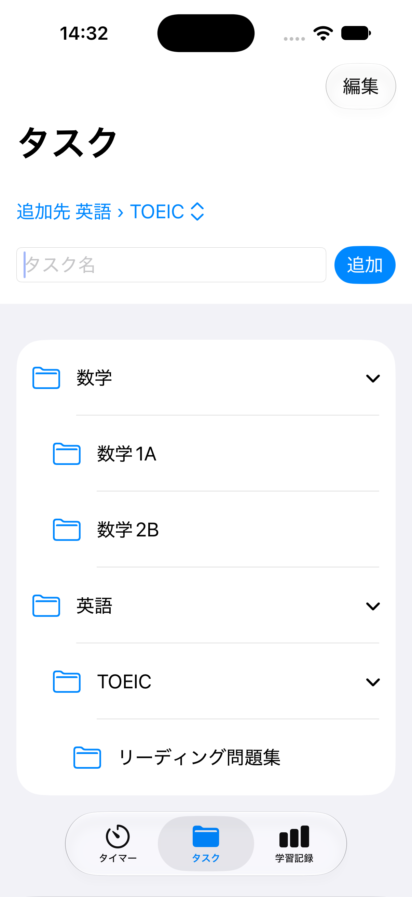
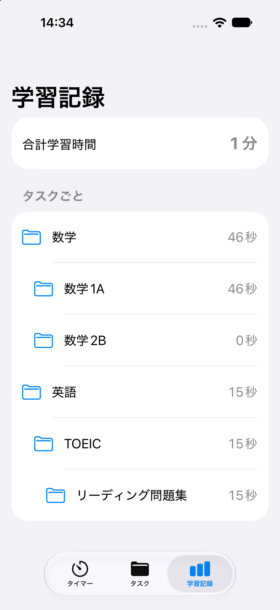

# PomodoroTimerAndStudyLog

ポモドーロタイマーと学習記録を1つにまとめた、iOS の学習管理アプリです。
タイマーを回すだけで、「どのタスクに、何分勉強したか」が、自動で記録されます。

## スクリーンショット

| タイマー | タスク | 学習記録 |
|---|---|---|
|  |  |  |

## 画面構成

下部のタブで、3つの画面を、切り替えます。

```
タイマー ── タスクを選んで、サイクル数を設定し、開始
タスク   ── 階層でタスクを管理(追加・名前変更・削除)
学習記録 ── 全体の合計と、階層ごとの合計を表示
```

## 制作背景

一般的なタイマーアプリは、作業時間の管理と、学習時間の記録が分かれています。
「タイマーで時間を計る」と「どの勉強に何分使ったかを記録する」を1つにまとめ、シンプルに使えるアプリを目指しました。

## ターゲットユーザー

勉強をする人全般(学生、資格試験の受験者、社会人の学習者など)。

## 主な機能

- **ポモドーロタイマー**: 学習25分 → 休憩5分のサイクルが、自動で進みます。サイクル数は画面で設定できます。学習時間 × サイクル数の目安も表示します。
- **タスクの階層管理**: タスクを最大3階層で管理できます。画面を移動せず、同じ画面で、子タスクを展開して表示します。追加先は、画面上部で選べます。
- **学習時間の自動集計**: 学習の25分だけが記録され、休憩は含まれません。途中で終了しても、経過した分だけが記録されます。
- **学習記録の一覧**: 全体の合計と、階層ごとの合計を、インデントして表示します。親の合計は、子の合計と、親自身の記録の合算です。
- **開始・終了の音**: 学習の開始と終了で、別々の音が鳴ります(アプリの使用中のみ)。
- **ダークモード・Dynamic Type に対応**しています。

## 使用技術

- 言語: Swift
- UI: SwiftUI(iOS 17以上)
- 設計: MVVM(`@Observable`)
- データ保存: SwiftData(ローカルのみ)
- 音: AudioToolbox(システムサウンド)
- 開発環境: Xcode、Git / GitHub
- 開発支援: Claude(Xcode のエージェント機能)
- 外部ライブラリ: 使用していません

## アーキテクチャ

```
View(SwiftUI)  ──  ViewModel(@Observable)  ──  Model(SwiftData)
  画面の表示          状態と処理                 StudyTask / StudyRecord
```

- View は、表示だけを担当し、状態と処理は、ViewModel に置いています。
- `StudyTask` が、親と子の一覧を、持っています(最大3階層)。子の削除は、親の削除と連動します。
- 学習記録(`StudyRecord`)は、子を持たないタスクにだけ、付きます。

## 技術選定の理由

- **SwiftUI**: 標準部品が多く、ダークモードや文字サイズの変更にも、自動で対応しやすいため。
- **MVVM**: 画面に処理を書かず、ViewModel に集めることで、タイマーの計算などを、画面と切り離して、確認できるため。
- **SwiftData**: Apple 標準の機能で、タスクと記録の親子関係や、削除時の連動を、モデルとして書けるため。
- **外部ライブラリなし**: 依存を増やさず、仕組みを、自分で理解できる範囲に、収めるため。
- **システムサウンド**: 音声ファイルを足さずに済み、容量や著作権の心配がないため。

## 工夫した点

- **正確な時間計算**: 1秒ごとに数えるのではなく、「終了予定時刻 − 現在時刻」で残り時間を計算します。画面が止まったり、処理が遅れたりしても、時間がずれません。
- **記録の保存は、終了時に1回だけ**: 一時停止のたびに保存せず、終了時にまとめて保存します。二重保存を防ぐ処理と、0秒の記録を保存しない処理を入れています。
- **削除に強い設計**: タイマーの実行中に、選択中のタスクが削除されても、アプリが落ちません。保存の直前に、タスクが残っているかを確認し、なければ記録を保存せずに終了します。
- **合計を二重に数えない**: 全体の合計は、第1階層のタスクの合計だけを足します。子の分は、親の合計にすでに含まれているためです。
- **テストしやすい作り**: 学習時間・休憩時間は、`TimerConfig` に、定数としてまとめました。Debug ビルドでは、学習10秒・休憩5秒になり、動作確認が短い時間でできます。音を鳴らす処理も、`SoundPlayer` というプロトコルで分け、Preview では、鳴らさない実装に差し替えられます。
- **iOS 標準の部品を優先**: `TabView`、`List`、`Alert` などの標準部品を使い、Apple の Human Interface Guidelines に沿った画面にしました。色はシステムカラーのみで、ダークモードでも読みやすくしています。
- **仕様書を先に作って開発**: 仕様と実装手順を `PLAN.md` にまとめ、ステップごとに、動作確認とコミットを繰り返しました。

## 苦労した点と解決方法

- **削除の確認が、キャンセルのない、ポップオーバーになった**
  - 原因: 確認ダイアログ(`confirmationDialog`)が、iOS 27 のシミュレータで、キャンセルボタンのない、ポップオーバーとして、表示された。
  - 対応: 標準の `Alert` に、置き換え、キャンセルが、必ず見えるようにした。
- **ダークモードで、行の背景が、見にくかった**
  - 原因: 背景色の組み合わせが、暗い画面で、コントラストが足りなかった。
  - 対応: システムカラーだけを使う、背景の部品を作り、ダークモードでも、読めるようにした。
- **選べなくなったタスクの、選択状態が、思ったとおりにならなかった**
  - 原因: 「未選択なら、先頭を自動で選ぶ」という処理が、選択を解除した直後にも、働いていた。
  - 対応: 自動選択は、最初の1回だけにし、解除されたあとは、ユーザーが選び直すまで、未選択のままにした。

## 今後の実装予定

- タスクのアイコンの選択(フォルダ・本・動画)
- フォルダの並び替え
- タイマー時間(25分/5分)の変更
- 音の種類の選択

## 動作確認の方法

GitHubからリポジトリをクローン
git clone https://github.com/LucianApple/PomodoroTimerAndStudyLog.git

プロジェクトディレクトリに移動
cd PomodoroTimerAndStudyLog

Xcodeでプロジェクトを開く
open PomodoroTimerAndStudyLog.xcodeproj

1. iPhone シミュレータを選んで、実行します(⌘R)。
2. **Xcode から、そのまま実行した場合(Debug ビルド)は、動作確認用に、学習10秒・休憩5秒で動きます。**
3. 本番の学習25分・休憩5分で試すには、画面上部のProduct → Scheme → Edit Scheme → Run → Build Configuration を **Release** に変えて、実行してください。
4. 音が鳴らない場合は、Mac の音量と、シミュレータ・端末のサイレント設定を、確認してください。

## テスト

自動テストは、未実装です。シミュレータで、次を手動で確認しています。

- タイマーの、開始・一時停止・再開・終了、サイクルの自動進行
- 階層の追加・名前変更・削除、削除時の確認
- 学習記録の合計(二重計上がないこと)
- タイマー実行中に、タスクを削除した場合の動作
- ダークモード、最大の Dynamic Type

## 制限事項

- 通知とバックグラウンド動作には、対応していません。バックグラウンドに移ると、タイマーの表示と音は止まり、戻ったときに、最新の状態に追いつきます。
- データは、端末内にのみ保存されます(クラウド同期なし)。

## 開発について

実装には、Xcode の Claude エージェントを使いました。仕様の決定、画面の設計、動作確認、修正の判断は、自分で行っています。
