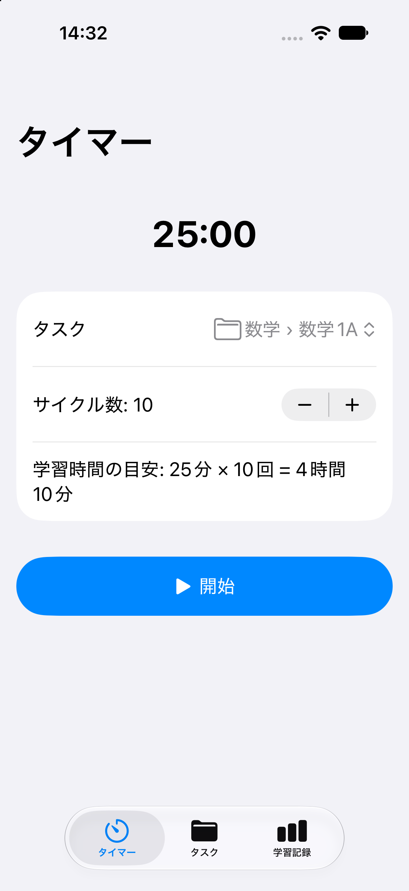

# PomodoroTimerAndStudyLog（基本機能実装済み段階）

ポモドーロタイマーと学習記録を1つにまとめた、iOS の学習管理アプリです。
タスクを選択してタイマーを開始するだけで、「どのタスクに、何分勉強したか」が自動で記録されます。

## スクリーンショット

| タイマー | タスク | 学習記録 |
|---|---|---|
|  |  |  |

## 画面構成

下部のタブで3つの画面を切り替えます。

```
タイマー ── タスクを選んで、サイクル数を設定し、開始
タスク   ── タスクを階層構造で管理(追加・名前変更・削除)
学習記録 ── 全体の合計と、階層ごとの合計を表示
```

## 主な機能

- **ポモドーロタイマー**: 学習25分 → 休憩5分のサイクルが、自動で進みます。サイクル数は画面で設定できます。設定したサイクル数に応じた予定合計学習時間も表示します。
- **タスクの階層管理**: タスクを最大3階層で管理できます。画面を移動せず、同じ画面で子タスクを展開して表示します。追加先は画面上部で選べます。
- **学習時間の自動集計**: 学習時間だけが記録され、休憩は含まれません。途中で終了しても、経過した分だけが記録されます。
- **学習記録の一覧**: 全体の合計を画面上部に表示し、階層ごとの合計をインデントして表示します（表示件数が増えると見にくくなるため、表示方法は後に別の形式へと変更予定）。親の合計は、子の合計と親自身の記録の合算です。
- **開始・終了の効果音**: 学習の開始と終了で、別々の効果音が鳴ります(アプリの使用中のみ)。
- **ダークモード・Dynamic Type に対応**しています。

## 制作背景

これまで、人気や評価の高いものを中心に、物理的な学習用タイマーや、学習用タイマーアプリを合計10〜20種類ほど利用してきました。しかし、いずれも自分が求める機能を十分に備えておらず、使い勝手の面でも不便を感じることがありました。

5年以上前から理想とする学習用タイマーの構想を持っており、App Storeで自分が求める機能を備えたアプリを探し続けてきました。数年間にわたって理想のアプリが新たに登場することを期待していましたが、求める機能を備えたものは見つかりませんでした。そこで、既存の学習タイマーには見られなかった機能を複数盛り込み、自分の理想とするアプリを自ら開発したいと考えるようになりました。

特に、次のような機能を実現したいと考えていました。

- **サイクル数に応じた学習時間の自動計算**： これまで、既存の学習用タイマーを利用する際、学習25分・休憩5分のポモドーロタイマーを1サイクルとして設定していましたが、何サイクル実行すれば合計で何時間何分の学習になるのかを、学習前に毎回電卓で計算する必要があり、手間に感じていました。そこで、サイクル数を設定すると、それに応じた予定合計学習時間を自動計算して表示する機能を考案しました。多くの学習用タイマーを利用してきた中でも見かけたことがなく、自分が感じていた不便さを解消するために考案した機能です。
- **階層構造による学習時間の管理**： 既存の学習用タイマーでは、一つの教材やタスク単位で学習記録を管理するものが多く、自分が調べた範囲では、3階層で学習時間を管理できるものを見つけられませんでした。そこで、科目・分野・教材（例：数学 → 数学1A → 各参考書）のように学習内容を3階層まで整理し、階層ごとに累計学習時間を確認できる機能を考えました。これにより、どの科目のどの分野で、どの教材をどれくらい学習したのかを把握し、学習時間の配分やバランスを確認できるようになります。
- **カウントアップ方式のポモドーロタイマー**： 現段階では未実装ですが、当初から実装したいと考えていた機能の一つです。自分が調べた範囲では、この方式を採用した学習タイマーアプリを見つけることができませんでした。25分、50分、1時間15分というように学習時間を累積して表示しながら、ポモドーロタイマーとして利用できる点に魅力を感じ、将来的に取り入れたいと考えています。

また、物理的な学習用タイマーを利用する際、タイマーで時間を計る作業と、学習内容や学習時間を記録する作業を別々に行う必要があり、手間に感じていました。そこで、これらを一つにまとめ、タイマーを使って学習するだけで、どのタスクに何分取り組んだかを自動で記録し、学習内容と時間をまとめて管理できるアプリを開発しました。

## ターゲットユーザー

勉強をする人全般(学生、資格試験の受験者、社会人の学習者など)。

## 使用技術

- 言語: Swift
- UI: SwiftUI
- 対応OS: iOS 17.0以上
- 設計: MVVM(`@Observable`)
- データ保存: SwiftData(ローカルのみ)
- 音声: AudioToolbox(システムサウンド)
- 開発環境: Xcode 27、Git / GitHub
- 開発支援: Claude Code(Xcode上で利用)、ChatGPT
- 外部ライブラリ: 使用していません

## アプリ開発全体の流れ

今回のアプリは、以下の手順で開発を進めました。

### 1. アプリの企画・アイデアの整理

まず、作りたいアプリのアイデアをiPadのメモ帳に書き出しました。対象ユーザー、解決したい課題、大まかな画面構成、基本機能、基本機能以外に実装したい機能を中心に整理しました。

### 2. Git・開発環境の準備

- **Gitのメールアドレス設定**： Gitの設定メールアドレスをGitHubのnoreplyアドレスに変更し、コミット履歴に個人のメールアドレスが記録・公開されることを防止しました。
- **Claude Codeのプラグイン設定**： ターミナルからClaude Codeに`feature-dev`と`Context7`の2つのプラグインをユーザースコープでインストールし、Xcode内でも利用できるように設定しました。なお、現時点では実際の開発で使用する機会はありませんでした。
- **XcodeとGitHubの連携**： GitHubでPersonal Access Token（Classic）を発行し、XcodeのSource Control設定からGitHubと連携しました。
- **.gitignoreの作成**： gitignore.ioからSwift用のテンプレートを取得し、プロジェクトフォルダ直下に`.gitignore`を作成しました。テンプレートに含まれていない`.DS_Store`、`.claude/settings.local.json`、`.env`、`*.log`も追加しました。初期段階では機密情報を扱わない方針でしたが、将来的に扱う可能性も考慮し、`.env`をあらかじめ除外対象に加えました。メモ帳で作った仕様は公開用の文章として整っていなかったため、それをもとに仕様をまとめた`CLAUDE.md`も、公開用に整えるまでは一旦除外対象にし、公開時に除外を解除しました。

### 3. 仕様の策定

`CLAUDE.md`に記載する仕様を、メモ帳に書き出した内容をもとに、AIと相談しながら整理しました。ChatGPTとClaude Codeの2種類のAIを使用し、一方が作成・修正した内容をもう一方に共有して検討・修正を交互に重ねることで、仕様の曖昧な記述や、考慮すべきエッジケースへの対応漏れがないかを確認し、仕様を具体化して内容の精度を高めました。

また、Apple公式のユーザーインターフェース設計ガイドラインであるHIG（Human Interface Guidelines）に準拠するよう指示し、重要な項目を選定して仕様に反映するよう依頼しました。`CLAUDE.md`の記述量が過度に増えないよう、目安を100行以内とし、必要な内容に絞って取り入れています。

完成した`CLAUDE.md`はプロジェクトフォルダ直下に配置しました。

### 4. Gitリポジトリの作成

プロジェクトフォルダをGitリポジトリとして初期化し、バージョン管理を開始できる状態にしました。

### 5. 実装手順の設計

`CLAUDE.md`にまとめた仕様をもとに、機能間の依存関係を考慮しながら実装順序を段階的に整理し、`PLAN.md`を作成しました。

作成した実装手順についても、両方のAIに交互に確認・修正を依頼し、指示の曖昧さやエラーにつながりやすい記述がないかを確認しました。

開発時の運用ルールとして、以下の方針を定めました。

- 1機能につき1ブランチ・1セッション（自分で考案）
- 1回の実装依頼につき1手順を実施し、完了後に1コミット（自分で考案）
- 各コミットの前に実施する手動動作検証の方法を、あらかじめ実装手順に記載（AIが提案）

### 6. 実装・検証

完成した`PLAN.md`に沿って、機能ごとに実装と動作検証を進めました。

## アーキテクチャ

```
View(SwiftUI)  ──  ViewModel(@Observable)  ──  Model(SwiftData)
  画面の表示          状態と処理                 StudyTask / StudyRecord
```

MVVMを採用し、画面表示を担当するViewと、状態管理・処理を担当するViewModelを分離しています。
データモデルにはSwiftDataを使用し、タスクと学習記録を端末内に保存します。

データ構造

- `StudyTask`: 学習タスクの情報と、親子関係を管理
- `StudyRecord`: タスクに紐づく学習時間を管理

タスクは最大3階層の親子関係を持ち、学習記録は選択可能な末端タスクに紐づけて保存します。
親タスクの学習時間は、自身に紐づく記録と子タスクの学習時間を合算して算出します。これにより、階層構造を維持したまま学習時間を集計できます。

## 技術選定の理由

- **SwiftUI**: 標準部品が多く、ダークモードや文字サイズの変更にも、自動で対応しやすいため。
- **MVVM**: 画面表示と状態管理・処理を分離し、タイマーの時間計算などをViewModel側で管理しやすくするため。
- **SwiftData**: Apple標準の機能で、タスクと学習記録の関連付けや、削除時の連動をモデルとして表現できるため。

## 工夫した点

- **正確な時間計算**: 1秒ごとに残り時間を減算するのではなく、終了予定時刻と現在時刻の差から残り時間を計算します。これにより、画面更新や処理の遅延による時間のずれが累積しにくい設計にしています。
- **記録の保存は終了時に1回だけ**: 一時停止のたびに保存せず、終了時にまとめて保存します。二重保存を防ぐ処理と、0秒の記録を保存しない処理を入れています。
- **タスク削除と学習記録の整合性**: タイマー実行中に対象タスクが削除されると、終了時に保存先のタスクが存在しない状態になる可能性がありました。そのため、保存処理の前に対象タスクの存在を確認し、削除されている場合は記録を保存しないようにしました。
- **合計を二重に数えない**: 全体の合計は、第1階層のタスクの合計だけを足します。子の分は、親の合計にすでに含まれているためです。
- **テストしやすい作り**: 学習時間・休憩時間は、`TimerConfig` に、定数としてまとめました。Debug ビルドでは、学習10秒・休憩5秒になり、動作確認が短い時間でできます。音を鳴らす処理も、`SoundPlayer` というプロトコルで分け、Preview では、鳴らさない実装に差し替えられます。
- **iOS 標準の部品を優先**: `TabView`、`List`、`Alert` などの標準部品を使い、Apple の Human Interface Guidelines に沿った画面にしました。色はシステムカラーのみで、ダークモードでも読みやすくしています。
- **仕様書を先に作って開発**: 仕様は`CLAUDE.md`、実装手順を `PLAN.md` にまとめ、ステップごとに、動作確認とコミットを繰り返しました。

## 苦労した点と解決方法

- **削除の確認がキャンセルのないポップオーバーになった**
  - 原因: 確認ダイアログ(`confirmationDialog`)が、iOS 27 のシミュレータで、キャンセルボタンのないポップオーバーとして表示された。
  - 対応: 標準の `Alert` に置き換えキャンセルが必ず見えるようにした。
- **ダークモードで行の背景が見にくかった**
  - 原因: 背景色の組み合わせが、暗い画面でコントラストが足りなかった。
  - 対応: システムカラーだけを使う背景の部品を作り、ダークモードでも読めるようにした。
- **選べなくなったタスクの選択状態が思ったとおりにならなかった**
  - 原因: 「未選択なら、先頭を自動で選ぶ」という処理が、選択を解除した直後にも働いていた。
  - 対応: 自動選択は最初の1回だけにし、解除されたあとは、ユーザーが選び直すまで未選択のままにした。

## 学び・振り返り

### AIエージェントの得意・不得意

#### 〜実装ロジックに関する学び〜
AIエージェントは、仕様書に明記していない入力チェックなどの処理についても、実装時に必要性を判断して補完できることが分かった。例えば、タスク名が空欄の場合に登録できないようにし、入力を促すメッセージを表示する処理は、仕様書に明記していなかったものの、AIエージェントが実装した。<br>

#### 〜UI設計における課題〜
一方、UI設計では、ユーザー体験を十分に考慮できていない提案が多かった。タスク管理画面の実装時には、階層を移動するたびに画面遷移が発生する構成や、各階層のタスクに追加ボタンを配置する構成が提案され、画面遷移やボタンの数が過剰になっていた。<br>

#### 〜開発を通じて得た学び〜
これらの経験から、実装ロジックについてはAIエージェントにある程度任せられるものの、UI設計については開発者自身が明確な方針を持ち、具体的な仕様や指示を検討したうえでAIに依頼する必要があると感じた。特に、ユーザー体験に関わる部分はAIエージェントの提案に委ねる範囲を限定し、開発者自身が積極的かつ主体的に設計・修正を行うことが重要だと感じた。

## 動作確認の方法

```
# GitHubからリポジトリをクローン
git clone https://github.com/LucianApple/PomodoroTimerAndStudyLog.git

# プロジェクトディレクトリに移動
cd PomodoroTimerAndStudyLog

# Xcodeでプロジェクトを開く
open PomodoroTimerAndStudyLog.xcodeproj
```

1. iPhone シミュレータを選んで、実行します(⌘R)。
2. Xcode から、そのまま実行した場合(Debug ビルド)は、動作確認用に学習10秒・休憩5秒で動きます。
3. 本番の学習25分・休憩5分で試すには、メニューバーのProduct → Scheme → Edit Scheme → Run → Build Configuration を **Release** に変えて、実行してください。
4. 音が鳴らない場合は、Mac の音量と、シミュレータ・端末のサイレント設定を確認してください。

## テスト

自動テストは未実装です。各コミット前に、iPhoneのシミュレータで手動で動作検証を済ませてあります。

- タイマーの開始・一時停止・再開・終了、サイクルの自動進行
- 階層の追加・名前変更・削除、削除時の確認表示
- 学習記録の合計(二重計上がないこと)
- タイマー実行中にタスクを削除した場合の動作
- ダークモード、最大の Dynamic Type<br>

など

## 制限事項

- 通知とバックグラウンド動作には対応していません。バックグラウンドに移ると、タイマーの表示と音は止まり、フォアグラウンドに戻ると現在時刻をもとにタイマーの状態を更新します。
- データは、端末内にのみ保存されます(クラウド同期なし)。

## 今後の追加機能実装予定

**タスクの管理・表示**

- タイマー画面のタスク選択を、タスク管理画面と同様に、階層ごとに整理された形で選べるようにする(タスク設定後の表示は変更せず、選択中の表示のみを変更する)
- 階層構造の勉強タスクを並び替えできるようにする
- 各階層の左側に、フォルダ・書籍・動画・音声のいずれかのアイコンを表示し、ユーザーが種類を選択できるようにする(最上位階層と中間階層はフォルダ、最下位階層は書籍をデフォルトとする)
- アイコン選択時に、色も設定できるようにする(カラフルな20色のプリセットから選択し、プリセット以外は、ユーザーが自由に作成できる)
- 各階層のフォルダを削除する際に、該当する学習時間の記録も併せて削除するか、フォルダのみを削除して記録は何らかの形で残すかを、ユーザーが選択できるようにする

**学習記録の表示・分析**

- 勉強した日の日付を、学習記録の画面に表示する(日付自体は、すでに保存している)
- 学習記録閲覧画面の上部に、1日・1週間・1ヶ月間の累計学習時間を表示するボタンを設け、各階層ごとの学習時間とは別に、自動で集計して表示する
- 各階層の下(画面上の下側で、階層構造上の下ではない)に、下位の階層の学習時間の割合を円グラフで表示する(例: 数学を最上位階層とした場合、数学1Aと数学2Bの割合。使用した参考書の比率も表示でき、色はアイコンとして設定した色とする)
- 月間カレンダー上で、何日にどの参考書をどれくらい学習したかを一覧で確認できるようにする
- 学習時間の推移をグラフ化できるようにする
- 階層ごとに学習時間の文字の大きさを変更する(最上位はやや大きめ、中間は標準、最下位はやや小さめ)
- 合算に使用される部分(登録されている中で最上位の階層)の文字色を青色にする
- 1週間・1ヶ月の目標学習時間を設定し、期間経過後に、目標を上回ったか下回ったかを確認できるようにする(通知として実装する可能性あり)
- ポモドーロタイマーのサイクル終了後に、学習メモ(学習範囲や内容の要約など)を任意で追加でき、学習記録から履歴として振り返れるようにする
- インデントによる一覧表示をやめ、タスク件数が増えても見やすい形式へと変更する

**タイマー**

- タイマーの数字の周囲に円を表示し、時間の経過に応じて円が進み、25分経過時に完成するようにする(円の中心にカウントの数字を表示する)
- 計測時間のデフォルト(「25分→5分」)を、1分単位で変更できるようにする
- カウントアップ式のポモドーロタイマーを導入する
- 試験日までの残り日数をカウントする機能を追加する

**音声・効果音**

- タイマーの開始効果音と終了効果音を、ユーザーの好みで選択できるようにする
- 開始効果音と終了効果音の音量を調整できるようにする(iPhone本体の音量調整と、アプリ内の音量調整の両方で、細かく調整できる)
- タイマー音をインポートできるようにする(ファイルアプリから音声ファイルを取り込む)
- 学習時間中に、ホワイトノイズや自然音を再生できるようにする

**設定・ヘルプ**

- ユーザー設定を、画面右下に4つ目のタブとして配置、もしくは全画面の左上にボタンとして配置して、ダークモード設定やタイマー音の選択など基本的な設定を配置する
- アプリの使い方を確認できる「i」マークを設け、タップすると使い方を表示する

**バックグラウンド・同期**

- バックグラウンドでも、学習・休憩の切り替わりと終了を通知で知らせるようにする
- クラウドと連携し、複数端末間で学習記録を共有できるようにする

## 今後の開発全体の予定

**品質向上・開発環境の整備**

- Swift Testingを用いたテストコードの実装
- SwiftLintによる静的解析ツールの導入
- GitHub Actions、または、Xcode Cloudを利用したCI/CD環境の構築

**収益化・リリース**

- フリーミアムモデルを採用した収益化機能の実装
- TestFlightを利用したベータ版の配信
- App Storeでの公開

## 今後習得したいスキル・取り組みたいこと

- **デザインツールの活用**：デザインツールFigmaを使って頭の中にあるイメージを画面設計に落とし込み、AIと連携して実装できるようになる。
- **UIデザインの理論**：書籍などを通じてUI設計の原則や理論的な知識を学び、根拠に基づいた画面設計ができるようになる。
- **開発手法**：テスト駆動開発（TDD）や仕様駆動開発などを習得し、開発に取り入れる。
- **アプリマーケティング**：ユーザー獲得や継続利用につながる施策を学び、効果的な収益化につなげる。


